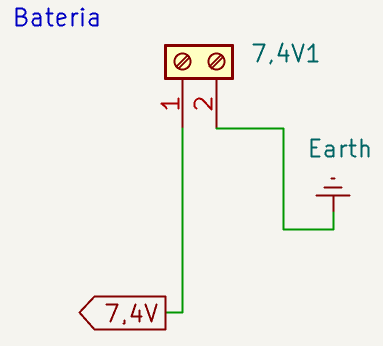
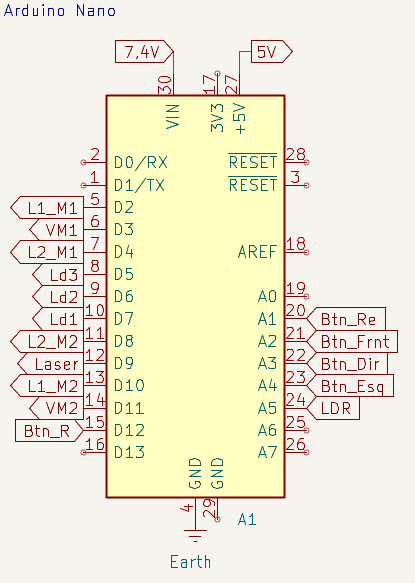
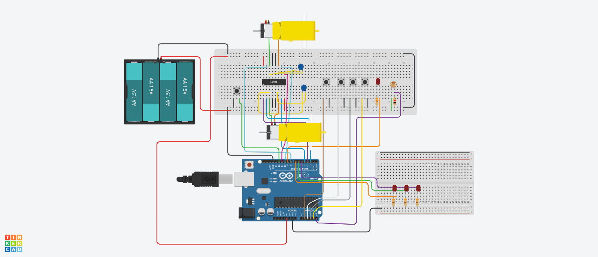
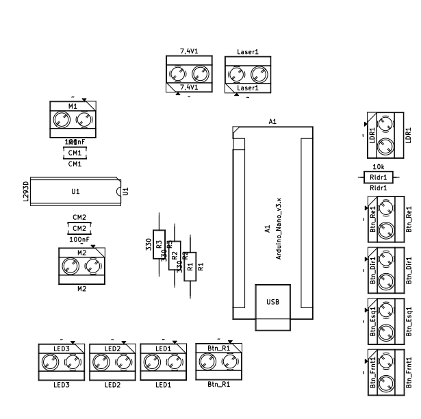
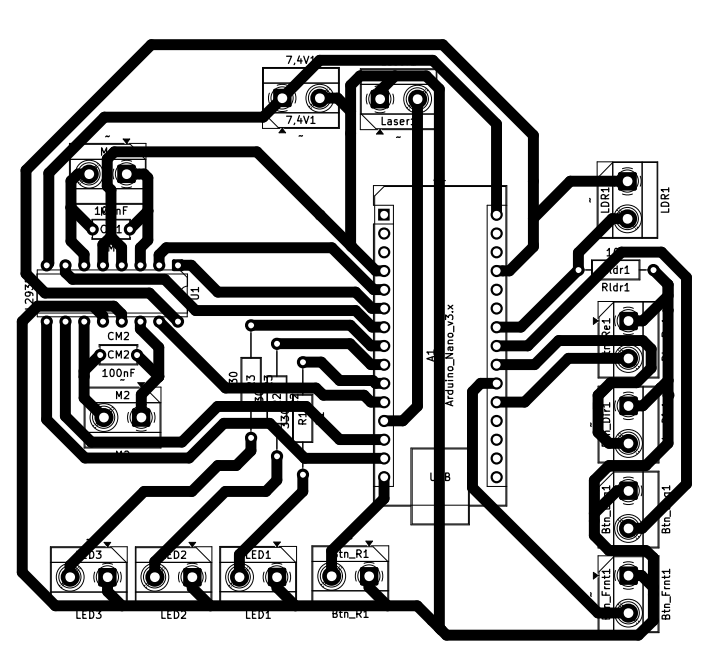
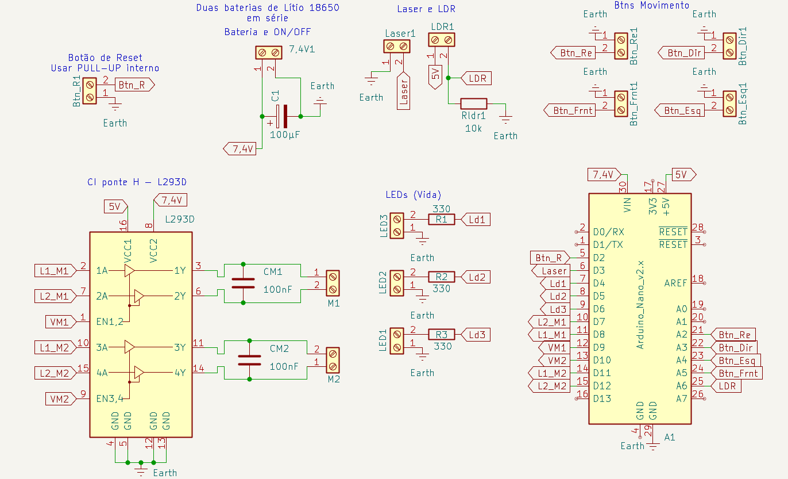

# Histórico da Placa – Gigantes de MDF

Registro da evolução do esquemático e da PCB do projeto. Cada versão traz o que foi feito, o que mudou e por quê. As versões ficam da mais recente para a mais antiga.

## Visão geral

- **Microcontrolador:** ATmega328P, em um módulo Arduino Nano (16 MHz).
- **Driver dos motores:** L293D (ponte H em CI, sem shield pronto).
- **Alimentação:** duas baterias de lítio 18650 em série (7,4 V). A partir da v2.0, também pode ser 4 pilhas alcalinas de 1,5 V em série.
- **Ferramenta do esquemático e da PCB:** KiCad.
- **Simulação:** Tinkercad.

---

## Versão 2.0 – 16/10/2026

Nova ligação dos pinos no Arduino Nano e novo projeto da PCB.

### Esquemático

Os blocos do L293D, laser, LDR, LEDs e botões seguem os mesmos da v1.0. Mudaram a alimentação e a ligação dos sinais no Arduino Nano.

**Alimentação**
- O capacitor `C1` (100 µF) foi removido.
- A bateria pode ser as 2 baterias de lítio 18650 em série (como na v1.0) ou 4 pilhas alcalinas de 1,5 V em série. Em ambos os casos ela é ligada ao conector `7,4V1`.

<table>
  <tr>
    <td align="center"> Bateria, sem o capacitor C1</td>
    <td align="center"> Ligações no Arduino Nano</td>
  </tr>
</table>
<em>Esquemático v2.0 (KiCad)</em>

**Ligações no Arduino Nano**

| Sinal | Pino do Nano | Porta do ATmega328P | Função |
|---|---|---|---|
| `L1_M1` | D2 | PD2 | Saída (sentido do motor 1) |
| `VM1` | D3 | PD3 | PWM, `OC2B` (velocidade do motor 1) |
| `L2_M1` | D4 | PD4 | Saída (sentido do motor 1) |
| `Ld3` | D5 | PD5 | Saída (LED de vida) |
| `Ld2` | D6 | PD6 | Saída (LED de vida) |
| `Ld1` | D7 | PD7 | Saída (LED de vida) |
| `L2_M2` | D8 | PB0 | Saída (sentido do motor 2) |
| `Laser` | D9 | PB1 | Saída |
| `L1_M2` | D10 | PB2 | Saída (sentido do motor 2) |
| `VM2` | D11 | PB3 | PWM, `OC2A` (velocidade do motor 2) |
| `Btn_R` (reset das vidas) | D12 | PB4 | Entrada com pull-up |
| `Btn_Re` (trás) | A1 | PC1 | Entrada com pull-up |
| `Btn_Frnt` (frente) | A2 | PC2 | Entrada com pull-up |
| `Btn_Dir` (direita) | A3 | PC3 | Entrada com pull-up |
| `Btn_Esq` (esquerda) | A4 | PC4 | Entrada com pull-up |
| `LDR` | A5 | PC5 (ADC5) | Entrada analógica (ADC) |

Pinos sem uso: D0/D1 (serial), D13, A0, A6 e A7.

**Mudanças em relação à v1.0**

| Sinal | v1.0 | v2.0 |
|---|---|---|
| `L1_M1` | D8 | D2 |
| `L2_M1` | D7 | D4 |
| `VM1` | D9 | D3 |
| `VM2` | D10 | D11 |
| `L1_M2` | D11 | D10 |
| `L2_M2` | D12 | D8 |
| `Laser` | D3 | D9 |
| `LDR` | A6 | A5 |
| `Btn_R` | D2 | D12 |
| `Btn_Re` | A2 | A1 |
| `Btn_Frnt` | A5 | A2 |
| `Ld1` / `Ld2` / `Ld3` | D4 / D5 / D6 | D7 / D6 / D5 |
| `Btn_Dir`, `Btn_Esq` | A3, A4 | A3, A4 (sem mudança) |

Motivo da mudança: Falha da primeira placa e considerações feitas durante o estudo e o desenvolvimento dos requisitos e do programa necessários para o projeto funcionar.

### Simulação no Tinkercad

O circuito do Tinkercad (Arduino Uno) corresponde à versão 2.0.

   
  Simulação da v2.0 no Tinkercad

### PCB

Layout feito no KiCad, com o Arduino Nano v3.x (`A1`)

<table>
  <tr>
    <td align="center"> Posicionamento (antes do roteamento)</td>
    <td align="center"> Placa roteada</td>
  </tr>
</table>
<em>PCB v2.0 (KiCad)</em>

---

## Versão 1.0 – 06/09/2026

### Esquemático

Primeira versão do esquemático, organizada em blocos.

   
  Esquemático v1.0 (KiCad)

**Ligações no Arduino Nano**

| Sinal | Pino do Nano | Porta do ATmega328P | Função |
|---|---|---|---|
| `Btn_R` (reset das vidas) | D2 | PD2 | Entrada, `INT0` |
| `Laser` | D3 | PD3 | Saída |
| `Ld1` | D4 | PD4 | Saída (LED de vida) |
| `Ld2` | D5 | PD5 | Saída (LED de vida) |
| `Ld3` | D6 | PD6 | Saída (LED de vida) |
| `L2_M1` | D7 | PD7 | Saída (sentido do motor 1) |
| `L1_M1` | D8 | PB0 | Saída (sentido do motor 1) |
| `VM1` | D9 | PB1 | PWM, `OC1A` (velocidade do motor 1) |
| `VM2` | D10 | PB2 | PWM, `OC1B` (velocidade do motor 2) |
| `L1_M2` | D11 | PB3 | Saída (sentido do motor 2) |
| `L2_M2` | D12 | PB4 | Saída (sentido do motor 2) |
| `Btn_Re` (trás) | A2 | PC2 | Entrada com pull-up |
| `Btn_Dir` (direita) | A3 | PC3 | Entrada com pull-up |
| `Btn_Esq` (esquerda) | A4 | PC4 | Entrada com pull-up |
| `Btn_Frnt` (frente) | A5 | PC5 | Entrada com pull-up |
| `LDR` | A6 | ADC6 | Entrada analógica (ADC) |

Pinos sem uso: D0/D1 (serial), D13, A0, A1 e A7.