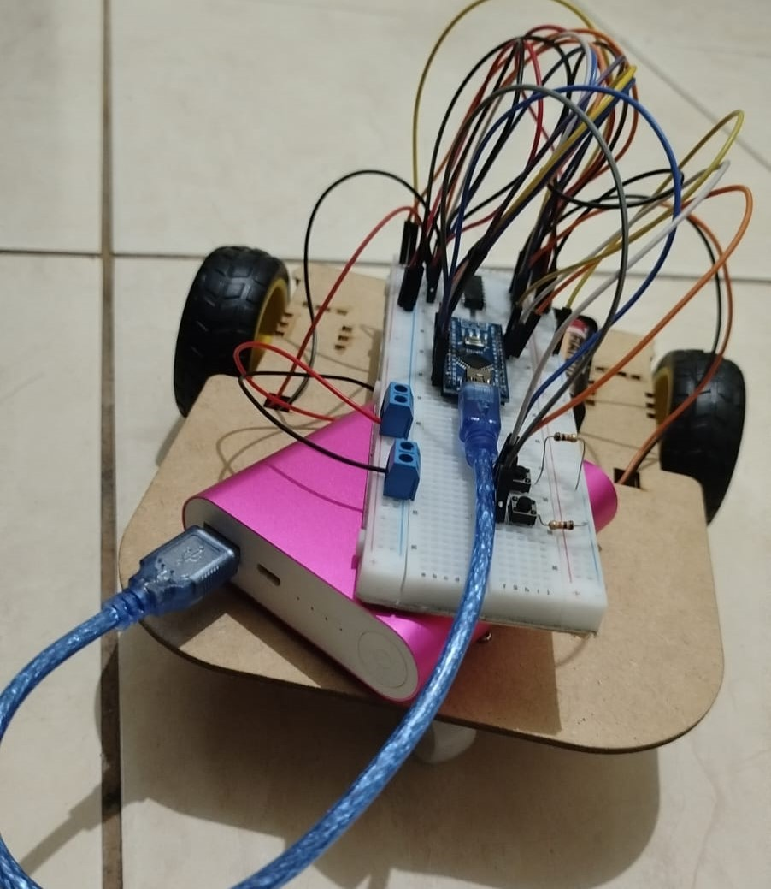
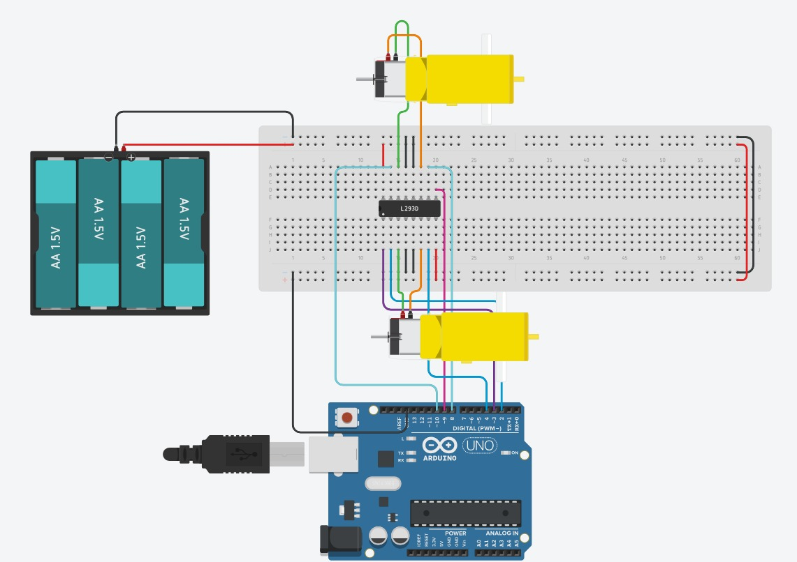

# Gigantes de MDF
##  Sobre o projeto
O projeto Gigantes de MDF foi desenvolvido como parte da disciplina de Programação de Hardware, com o objetivo de aplicar na prática os conhecimentos adquiridos durante o semestre, especialmente na programação de microcontroladores, no controle de componentes eletrônicos e na integração entre software e hardware.

A proposta consiste no desenvolvimento de um robô móvel controlado por meio de botões, permitindo realizar movimentos para frente, para trás, para a esquerda e para a direita, além de interromper o movimento quando os botões deixam de ser pressionados.

   
  <em>Primeiro Milestone, quase desatre mas já consegui andar</em>

##  Testes e placas
Talvez o mais essencial para que tenhamos um carrinho que funcione o tempo todo!!!

   
  <em>Dica, sempre utilizar o tinkercad para nao errar na Proto!</em>

##  Tecnologias e conceitos
- Linguagem: C/C++ para Arduino.
- Plataforma: Arduino IDE.
- Entradas digitais: leitura dos botões.
- Saídas digitais: controle do sentido de rotação dos motores.
- PWM: controle da velocidade dos motores.
- Funções: organização das ações de movimento.
- Estruturas condicionais e switch case: seleção dos movimentos conforme os comandos recebidos.

##  Considerações finais
O desenvolvimento deste projeto permite consolidar os conhecimentos de programação de hardware por meio de uma aplicação prática, aproximando a programação do funcionamento de um sistema físico real.

A proposta prioriza a programação e a integração entre os componentes eletrônicos, mantendo a complexidade mecânica dentro do necessário para o funcionamento do robô. Dessa forma, o grupo busca desenvolver uma solução funcional, organizada e de fácil compreensão, aplicando os conceitos estudados ao longo da disciplina.
