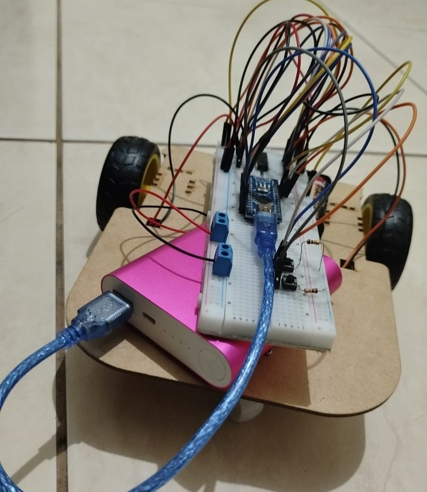
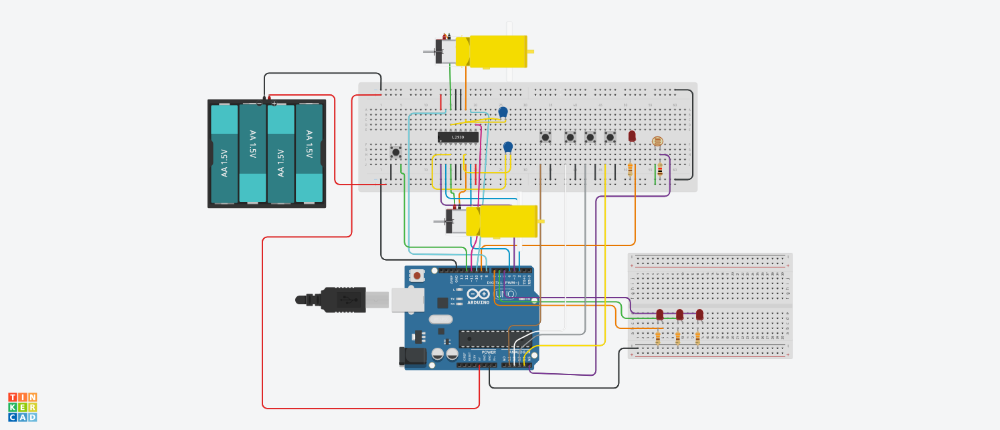
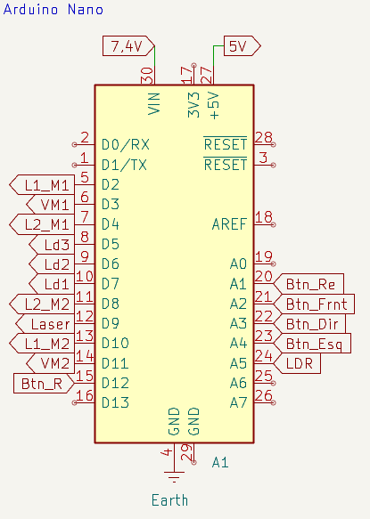
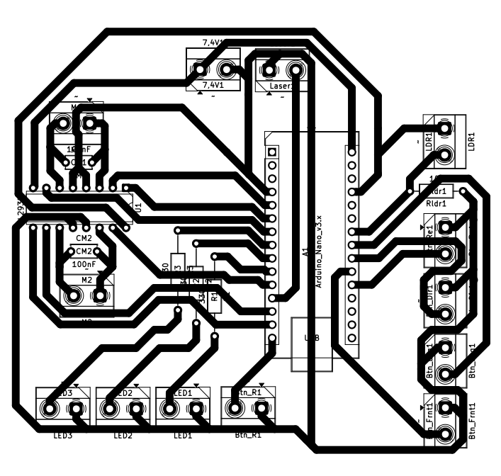

# Gigantes de MDF

## Sobre o projeto
O projeto Gigantes de MDF foi desenvolvido como parte da disciplina de Programação de Hardware, com o objetivo de aplicar na prática os conhecimentos adquiridos durante o semestre, especialmente na programação de microcontroladores, no controle de componentes eletrônicos e na integração entre software e hardware.

A proposta é um duelo entre robôs móveis: cada robô é controlado por botões, dispara um laser vermelho e tem um sensor de luz (LDR) que detecta o laser do adversário. Cada acerto tira uma das três vidas do robô, indicadas por LEDs. O foco do trabalho é a **programação direto nos registradores do ATmega328P**, sem bibliotecas prontas.

   
  <em>Primeiro milestone: quase um desastre, mas já andou</em>

## Como o robô funciona
- **Movimento:** o robô anda para frente, para trás e gira para a esquerda e para a direita enquanto o botão correspondente estiver pressionado. Se mais de um botão de movimento for apertado ao mesmo tempo, o robô para.
- **Laser:** fica 1 segundo ligado e 1 segundo desligado, controlado por um timer.
- **Acerto:** quando o LDR detecta o laser do adversário, o robô perde uma vida (um LED apaga), gira no próprio eixo e fica 5 segundos parado, com os motores e o receptor desativados.
- **Eliminação:** com as três vidas esgotadas, o robô fica parado até o botão de reset ser apertado, que devolve as três vidas.

## Hardware
O circuito foi simulado no Tinkercad e depois montado em uma PCB projetada no KiCad.

| Componente | Função |
|---|---|
| Arduino Nano (ATmega328P, 16 MHz) | microcontrolador |
| L293D | ponte H que aciona os dois motores |
| 2 motores DC | movimento do robô |
| Laser vermelho de 5 mW | arma |
| LDR + resistor de 10 kΩ | receptor do laser (divisor de tensão lido pelo ADC) |
| 3 LEDs + resistores de 330 Ω | vidas do robô |
| 5 botões | frente, trás, esquerda, direita e reset |
| 2 capacitores de 100 nF | filtro de ruído nos terminais dos motores |
| Bateria | 2 células de lítio 18650 em série (7,4 V) ou 4 pilhas alcalinas AA |

### Ligação dos pinos (esquemático v2.0)

| Função | Pino do Nano |
|---|---|
| Motor esquerdo: habilitação (PWM) / sentido | D3 / D2 e D4 |
| Motor direito: habilitação (PWM) / sentido | D11 / D10 e D8 |
| Botões: frente / trás / esquerda / direita | A2 / A1 / A4 / A3 |
| Botão de reset | D12 |
| LDR (entrada analógica) | A5 |
| Laser | D9 |
| LEDs de vida | D5, D6 e D7 |

   
  <em>Circuito da versão 2.0 no Tinkercad</em>

  
   
  <em>Esquemático (ligações do Nano) e PCB da versão 2.0, feitos no KiCad</em>

A evolução do esquemático e da PCB, com as versões e os motivos de cada mudança, está em [HISTORICO_PLACA.md](HISTORICO_PLACA.md).

## Software
O firmware é escrito em C/C++ para o microcontrolador AVR, direto nos registradores: não usa funções do Arduino como `digitalWrite`, `analogWrite` ou `millis`.

| Periférico | Uso |
|---|---|
| Timer1 (modo CTC) | base de tempo de 1 ms e controle do laser (1 s ligado, 1 s desligado) |
| Timer2 (Fast PWM de 8 bits) | PWM dos dois motores, por volta de 976 Hz |
| ADC (canal 5) | leitura do LDR |
| USART0 | mensagens de depuração a 115200 baud (valor do LDR, vidas e eventos) |

O programa é uma máquina de estados com três estados: **ativo** (controle manual e leitura do LDR), **atingido** (giro e pausa de proteção) e **eliminado** (aguarda o reset).

### Parâmetros ajustáveis
Ficam no começo do código. O limiar do LDR e o tempo do giro foram medidos e ajustados na placa:

| Constante | Valor | Significado |
|---|---|---|
| `VELOCIDADE` | 200 | duty do PWM (0 a 255) |
| `TEMPO_GIRO_MS` | 500 | duração do giro após um acerto |
| `TEMPO_PROTECAO_MS` | 5000 | tempo com motores e receptor desativados |
| `LDR_LIMIAR_DISPARO` | 800 | leitura do ADC (0 a 1023) que indica laser |
| `LDR_CONFIRMACOES` | 6 | leituras seguidas (uma a cada 5 ms) para confirmar o acerto |
| `DEBOUNCE_MS` | 20 | tempo de estabilidade dos botões de movimento |

### Estrutura do repositório
| Item | Conteúdo |
|---|---|
| `script/` | código do firmware |
| `assets/` | imagens do projeto (fotos, esquemático, PCB) |
| `HISTORICO_PLACA.md` | histórico do esquemático e da PCB |

## Documentação do software
Os comentários do código seguem o padrão do **Doxygen** (`/** ... */`, com `@brief`, `@param` e `@return`). A documentação gerada fica na pasta [`docs/`](docs/): abra o `docs/index.html` no navegador. A página inicial dela é este próprio README.

Para gerar de novo (por exemplo, depois de mudar o código), na raiz do projeto:

1. `doxygen Doxyfile`
2. copie a pasta `assets` para dentro de `docs` (as imagens do README usam o caminho `assets/...`).

## Milestones
| Data | Entrega |
|---|---|
| 05/10/2026 | estrutura funcional do robô, andando com baterias |
| 26/10/2026 | circuito com motores, sensor e laser ligados ao microcontrolador |
| 23/11/2026 | apresentação do projeto final |

## Considerações finais
O desenvolvimento deste projeto permite consolidar os conhecimentos de programação de hardware por meio de uma aplicação prática, aproximando a programação do funcionamento de um sistema físico real.

A proposta prioriza a programação e a integração entre os componentes eletrônicos, mantendo a complexidade mecânica dentro do necessário para o funcionamento do robô. Dessa forma, o grupo busca desenvolver uma solução funcional, organizada e de fácil compreensão, aplicando os conceitos estudados ao longo da disciplina.
